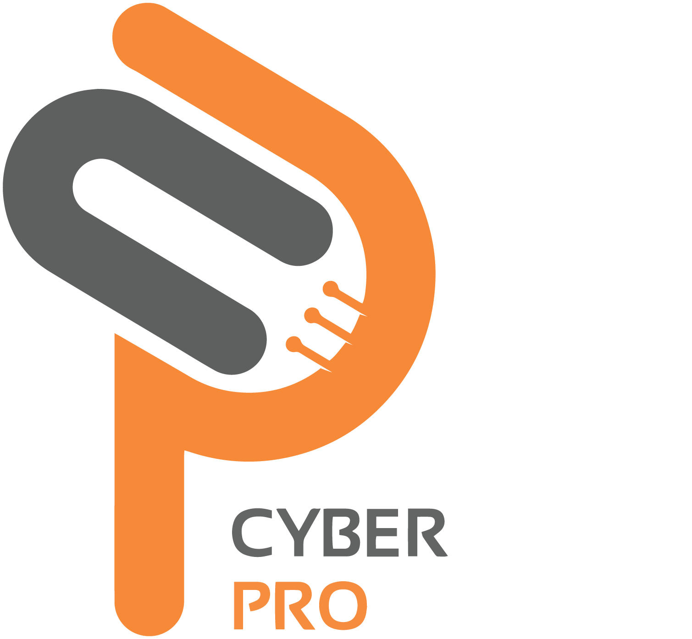
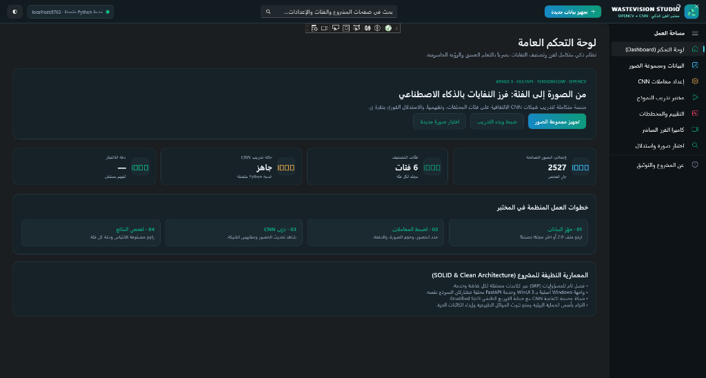
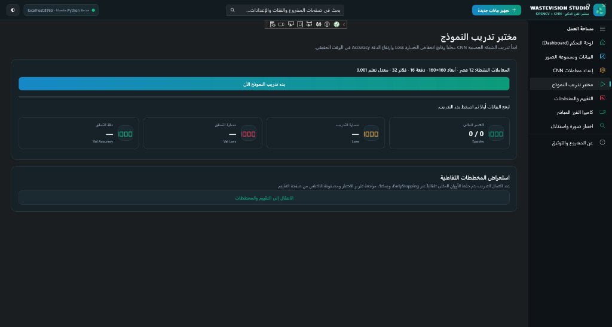
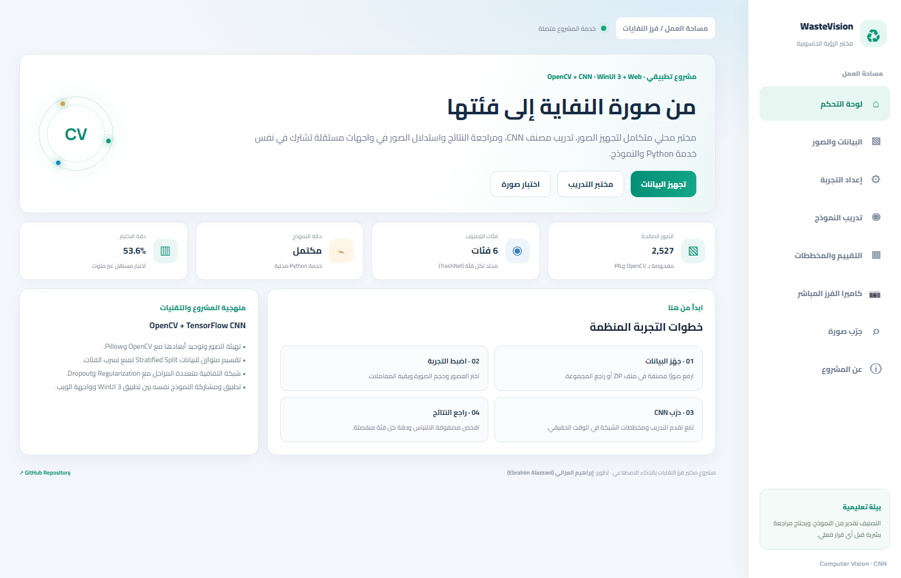
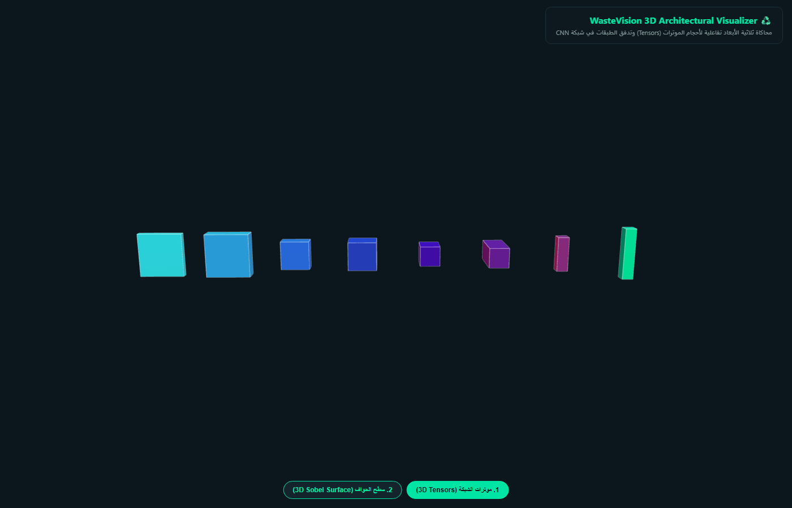
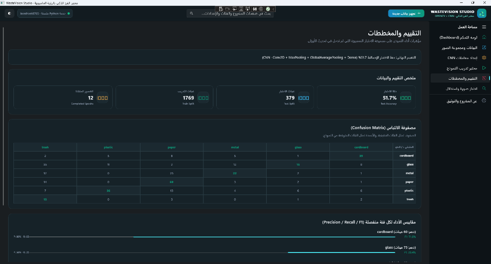
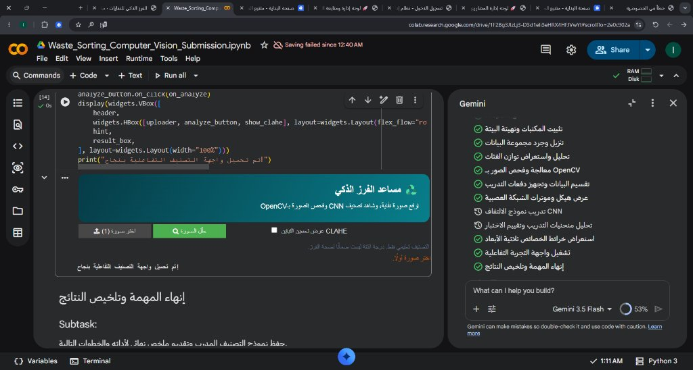
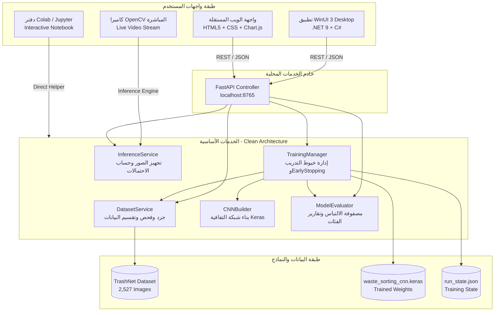

<p align="center">
  
</p>

# ♻️ WasteVision Studio · مختبر الفرز الذكي بالرؤية الحاسوبية
### *Smart Waste Sorting Laboratory with Deep Learning & Computer Vision*

<p align="center">
  <a href="https://github.com/ebrahim-alazzani/WasteVision-Studio"></a>
  
  
  
  
  
  
</p>

---

## 👨‍💻 المطور وبيانات المشروع (Developer & Project Info)

* **المطور الرئيسي:** **إبراهيم العزاني (Ebrahim Alazzani)**
* **حساب GitHub:** [@ebrahim-alazzani](https://github.com/ebrahim-alazzani)
* **رابط المستودع:** [https://github.com/ebrahim-alazzani/WasteVision-Studio](https://github.com/ebrahim-alazzani/WasteVision-Studio)
* **مجال العمل:** الرؤية الحاسوبية (Computer Vision)، التعلم العميق (Deep Learning)، وهندسة برمجيات سطح المكتب والويب.

---

## 📖 نظرة عامة على المشروع (Project Overview)

**WasteVision Studio** هو منصة تعليمية وتطبيقية متكاملة للرؤية الحاسوبية (Computer Vision) والتعلم العميق (Deep Learning) متخصصة في **تصنيف وفرز النفايات تلقائياً** إلى 6 فئات رئيسية مستندة إلى مجموعة بيانات **TrashNet**:
1. **الكرتون (Cardboard)**
2. **الزجاج (Glass)**
3. **المعادن (Metal)**
4. **الورق (Paper)**
5. **البلاستيك (Plastic)**
6. **النفايات العامة (Trash)**

يتميز المشروع بدمج متكامل وموحد يخدم 3 واجهات تشترك في نفس خدمة الذكاء الاصطناعي ونفس النموذج والبيانات:
- **تطبيق Windows أصلي بـ WinUI 3 (.NET 9):** واجهة عصرية بتصميم Fluent Design 2، شريط علوي شفاف ومندمج، لوحة تنقل جانبية، ورسوم بيانية ومخططات تفاعلية.
- **واجهة ويب تفاعلية حديثة:** لوحة تحكم بشاشات مستقلة، بطاقات أداء KPI، ومخططات حيّة للعصور وتوزيع الاحتمالات.
- **كاميرا الفرز الذكي المباشر (Live Real-time Camera):** معالجة فيديو حي ومباشر عبر **OpenCV** و **WebRTC** مع مستطيل استهداف ذكي وتصنيف فوري بمعدل 30+ إطار بالثانية (FPS).
- **دفتر Jupyter / Google Colab:** تجربة استكشافية تفاعلية مع توثيق ودوال مساعدة موثوقة.

---

## 🖼️ لقطات من التطبيق والمنظومة (Visual Showcase)

### 1. تطبيق الويندوز الأصلي (WinUI 3 & .NET 9 Desktop App)
| لوحة التحكم الرئيسية (WinUI 3 Dashboard) | مختبر تدريب الشبكة والمنحنيات الحية (Training Lab) |
|:---:|:---:|
|  |  |

### 2. منصة الويب والمحاكاة ثلاثية الأبعاد (Web Platform & 3D AI Visualizer)
| لوحة تحكم الويب المتجاوبة (Responsive Web UI) | محاكاة الموترات ثلاثية الأبعاد (3D Architecture Visualizer) |
|:---:|:---:|
|  |  |

### 3. مصفوفة الالتباس والمسار التفاعلي (Confusion Matrix & Interactive Pipeline)
| واجهة التقييم ومصفوفة الالتباس (Results & Confusion Matrix) | مسار التنفيذ التفاعلي الموحد (Interactive Pipeline) |
|:---:|:---:|
|  |  |

---

## 🏛️ البنية المعمارية ومبادئ التصميم (Architecture & SOLID Principles)

تم بناء المشروع وفق مبادئ **Clean Architecture** و **SOLID Patterns**، حيث تم تفكيك الكلاسات الطويلة إلى خدمات متخصصة أحادية المسؤولية (Single Responsibility):



### وحدات النظام الأساسية:
- `core/dataset_service.py`: فحص ملفات الصور، استخراج ملفات ZIP، والتقسيم الطبقي المتوازن (Stratified Train/Val/Test Split).
- `core/cnn_builder.py`: بناء بنية شبكة الـ CNN، وضبط أوزان الفئات المتوازنة (Class Weights).
- `core/trainer_service.py`: إدارة دورة حياة التدريب في خيط منفصل (Background Thread) وحفظ التقدم لحظياً.
- `core/evaluator_service.py`: حساب الدقة، مصفوفة الالتباس (Confusion Matrix)، ومقاييس كل صنف (Precision, Recall, F1-Score).
- `core/inference_service.py`: تهيئة الصور بمكتبتي PIL و OpenCV وتوليد احتمالات Softmax ونصائح الفرز البيئي.
- `core/camera_runner.py`: محرك معالجة الكاميرا الحية المباشرة بـ OpenCV ورسم الـ HUD المتقدم.

---

## 📊 مجموعة البيانات (Dataset - TrashNet)

تم اختبار وتدريب النموذج على مجموعة بيانات **TrashNet** القياسية المكونة من **2,527 صورة ملونة**:
- **cardboard (كرتون):** 403 صورة
- **glass (زجاج):** 501 صورة
- **metal (معادن):** 410 صورة
- **paper (ورق):** 594 صورة
- **plastic (بلاستيك):** 482 صورة
- **trash (نفايات عامة):** 137 صورة

التقسيم المعتمد:
- **70% تدريب (Training Split):** 1,769 صورة
- **15% تحقق (Validation Split):** 379 صورة
- **15% اختبار نهائي (Test Split):** 379 صورة (محجوزة بالكامل لتقييم مصفوفة الالتباس)

---

## 🧠 بنية الشبكة العصبية (CNN Architecture)

```
Input Image (RGB, 160×160×3)
  │
  ├── [Data Augmentation] (Random Flip, Rotation, Zoom) [خلال التدريب فقط]
  ├── [Rescaling 1/255.0]
  │
  ├── [Conv2D Block 1] : 32 Filters (3×3), ReLU + MaxPooling2D (2×2)
  ├── [Conv2D Block 2] : 64 Filters (3×3), ReLU + MaxPooling2D (2×2)
  ├── [Conv2D Block 3] : 128 Filters (3×3), ReLU + MaxPooling2D (2×2)
  │
  ├── [GlobalAveragePooling2D]
  ├── [Dropout] (Rate = 0.35)
  ├── [Dense Layer] : 64 Units, ReLU
  └── [Output Layer] : 6 Units, Softmax Activation
```

---

## 📈 التقييم والمخططات (Evaluation & Visual Charts)

يوفر التطبيق رسوماً بيانية تفاعلية:
1. **منحنى الخسارة (Loss Curve):** خسارة التدريب مقابل خسارة التحقق عبر جميع العصور.
2. **منحنى الدقة (Accuracy Curve):** دقة التدريب مقابل دقة التحقق لمراقبة الاستقرار ومنع فرط التخصيص (Overfitting).
3. **مصفوفة الالتباس (Confusion Matrix Table):** تفصيل دقيق لعدد الحالات المصنفة صحيحة أو خاطئة بين الأصناف الستة.
4. **مقاييس كل فئة منفصلة:** عرض الـ Precision والـ Recall والـ F1-Score لكل مادة بيئية.

---

## 📷 كاميرا الفرز المباشر (Live Real-Time Camera)

يتضمن المشروع ميزة الرؤية المباشرة عبر الكاميرا:
- **OpenCV Window:** نافذة مستقلة فائقة السرعة تعرض الفيديو المباشر من الويب كام بدقة 640×480 مع:
  - مستطيل تركيز واستهداف آلي (Target ROI).
  - تصنيف لحظي للفئة مع نسبة الثقة المئوية.
  - عداد سرعة الإطارات (FPS Counter).
  - إمكانية التقاط صورة فورية عبر زر `s` أو الخروج بزر `q`.
- **WebRTC Camera:** كاميرا مدمجة في صفحة الويب تعمل من خلال المتصفح مباشرة.

---

## 🚀 دليل التشغيل السريع (Getting Started)

### المتطلبات الأساسية (Prerequisites):
- **Windows 10 / 11 (x64)**
- **Python 3.10+** مع Anaconda أو بيئة افتراضية
- **.NET 9.0 SDK** (لتطبيق WinUI 3)

### التثبيت (Installation):
```bash
# تثبيت حزم بايثون المطلوبة
pip install -r requirements.txt
```

### خيارات التشغيل بنقرة واحدة (One-Click Runners):

#### 1. تشغيل تطبيق سطح المكتب (WinUI 3 Desktop App):
انقر مزدوجاً على:
```
run_desktop.bat
```
*(أو عبر PowerShell: `.\run_desktop.ps1`)*  
يقوم السكربت تلقائياً بتشغيل خدمة بايثون الخلفية في بيئة محلية وفتح نافذة تطبيق WinUI 3 مع المظهر المدمج والأيقونة الخاصة.

#### 2. تشغيل واجهة الويب (Web Dashboard):
انقر مزدوجاً على:
```
start_web.bat
```
*(أو افتح المتصفح على `http://127.0.0.1:8765/`)*

#### 3. تشغيل كاميرا الفرز الذكي المباشر (Live Camera):
انقر مزدوجاً على:
```
run_camera.bat
```

---

## 📂 هيكل ملفات المشروع (Repository Structure)

```
WasteVision-Studio/
├── core/                                # الخدمات الأساسية (Clean Architecture)
│   ├── config.py                        # المسارات والثوابت
│   ├── dataset_service.py               # فحص وتقسيم وحفظ البيانات
│   ├── cnn_builder.py                   # بناء شبكة CNN وحساب الأوزان
│   ├── trainer_service.py               # مدير التدريب المتوازي
│   ├── evaluator_service.py             # تقييم النموذج ومصفوفة الالتباس
│   ├── inference_service.py             # الاستدلال والتنبؤ بالصور
│   └── camera_runner.py                 # كاميرا الفرز المباشر OpenCV
├── desktop/                             # تطبيق WinUI 3 الأصلي (.NET 9)
│   ├── Assets/                          # أيقونات وشعار التطبيق (app.ico, app.png, logo.png)
│   ├── Common/                          # عناصر الواجهة المساعدة (UiFactory, CurveChartControl, NativeFileDialog)
│   ├── Models/                          # كائنات البيانات والبارامترات
│   ├── Services/                        # خدمات الاتصال بالواجهة الخلفية
│   ├── Views/                           # صفحات التطبيق (Overview, Data, Settings, Training, Results, Camera, Predict, About)
│   ├── MainWindow.xaml                  # الواجهة الرئيسية والشريط المدمج
│   └── WasteVision.Desktop.csproj       # ملف مشروع .NET 9 Unpacked x64
├── web/                                 # واجهة الويب التفاعلية
│   ├── index.html                       # تطبيق الصفحة الواحدة
│   └── static/                          # ملفات CSS والتنسيقات ومكتبات JS
├── docs/                                # الوثائق وشعار وصور المشروع
│   ├── logo.png                         # الشعار الرسمي للمطور
│   └── screenshots/                     # لقطات شاشات التطبيق التوضيحية
├── CV_Waste_Sorting_Colab.ipynb         # دفتر Jupyter التفاعلي
├── app.py                               # خادم FastAPI المحلي
├── waste_sorting_helpers.py             # دوال مساعدة لدفتر Colab
├── requirements.txt                     # متطلبات بايثون
├── run_desktop.bat                      # سكربت تشغيل الديسكتوب
├── start_web.bat                        # سكربت تشغيل الويب
├── run_camera.bat                       # سكربت تشغيل كاميرا OpenCV
├── .gitignore                           # استبعاد البيانات الثقيلة والملفات الثنائية
└── README.md                            # التوثيق الشامل والرسمي للمشروع
```

---

## 🐾 ملاحظات السلامة البيئية والحيوانية (Environmental & Animal Ethics)

- **حماية الحيوانات والحياة الفطرية:** النفايات البلاستيكية والمعدنية ذات الحواف الحادة تشكل خطراً بالغاً على الحيوانات الضالة والطيور والبيئات البحرية. يوضح التطبيق عند تصنيف كل نفاية إرشادات الشطف، والطي، والفرز الآمن لحماية البيئة الحيوية.
- **حدود النظام:** هذا النظام مصمم للأغراض التعليمية والبحثية، ويُوصى بوجود إشراف بشري في خطوط الفرز الصناعية المتقدمة.

---

## 📜 الترخيص (License)
المشروع متاح تحت رخصة **MIT License** المفتوحة المصدر.
تطوير: **[إبراهيم العزاني (Ebrahim Alazzani)](https://github.com/ebrahim-alazzani)**.
